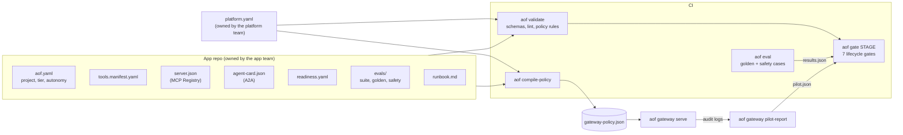
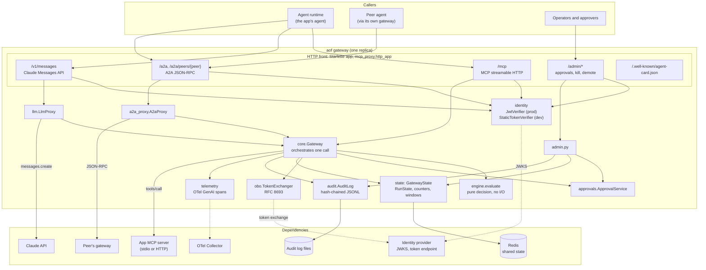
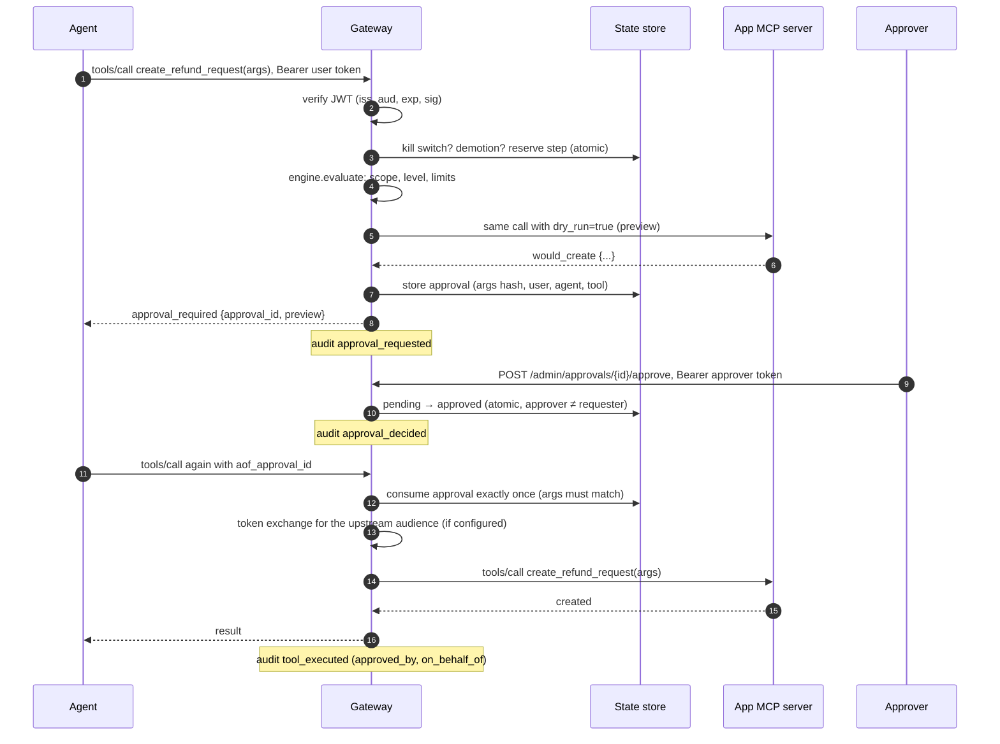
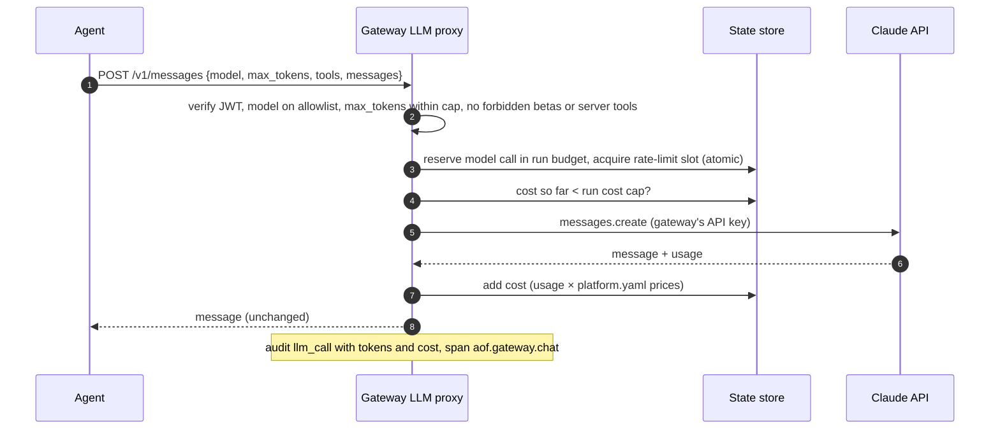
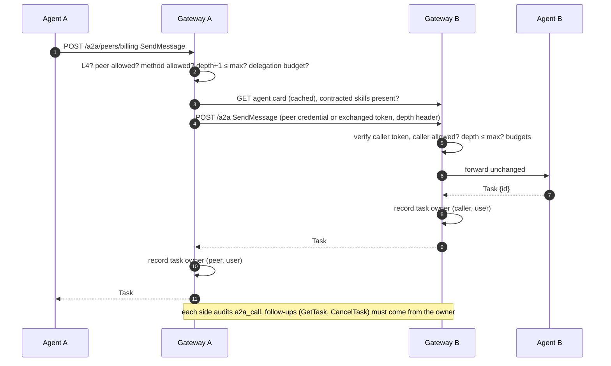

# Architecture

How the AOF kit and gateway fit together. Deployment and network layout are in
[deployment.md](deployment.md), threats in [threat-model.md](threat-model.md), and
telemetry and audit in [observability.md](observability.md).

## Two halves

AOF has a **build-time** half and a **run-time** half, joined by one file: the compiled
gateway policy.

- **Build time (the contract kit, `aof`).** An app team keeps seven artefacts in its repo.
  CI runs `aof validate` and the lifecycle gates on them. `aof compile-policy` turns the
  artefacts plus the platform's `platform.yaml` into `gateway-policy.json`.
- **Run time (the gateway, `aof gateway serve`).** Every tool call, model call and
  agent-to-agent call the agent makes goes through the gateway, which enforces that
  policy, asks humans for approval when the policy says so, and audits every decision.

The seven gates are intake, readiness, pattern, build, evaluate, pilot and promote.
Promotion moves an agent one autonomy level at a time:

| Level | Meaning | Gateway behaviour |
|-------|---------|-------------------|
| L0 | assist: read-only answers and drafts | read tools only |
| L1 | workflow: predefined steps, read-only | read tools only |
| L2 | supervised agent | every write needs a human approval |
| L3 | bounded autonomy | low-risk writes inside the tool's limits run; others need approval |
| L4 | delegated multi-agent | as L3, plus agent-to-agent delegation (A2A) |

T4 tools (irreversible, high-impact) are compiled as `deny` at every level.

## Gateway components

| Module | Responsibility | Rule it keeps |
|--------|----------------|---------------|
| `engine.py` | one decision per call: allow, deny, needs approval, dry run | no I/O, no transport code |
| `core.py` | runs a tool call: step budget, evaluate, approval, dry-run preview, token exchange, upstream call, audit, span | every decision is audited |
| `mcp_proxy.py` | MCP front (stdio or streamable HTTP) and the upstream MCP client | MCP specifics only here |
| `llm.py` | `/v1/messages`: model allowlist, token caps, budgets, rate limit, cost from usage | official `anthropic` SDK only |
| `a2a_proxy.py` | outbound and inbound A2A: peers, callers, depth, delegation budget, task ownership | forwards JSON-RPC unchanged |
| `approvals.py` | one approval per action, bound to tool, args, user and agent; single use | no self-approval |
| `obo.py` | exchange the user's token for one scoped to the upstream | exchange only after allow; fail closed; never log tokens |
| `jwt_verifier.py` | verify JWT access tokens against the IdP's JWKS | asymmetric algorithms only |
| `admin.py` | operator and approver API | decider comes from the verified token |
| `state.py` | `Store` protocol: memory, file, Redis | limit checks are atomic in the store |
| `audit.py` | append-only hash chain per replica | arguments hashed, not stored |
| `telemetry.py` | OTel GenAI spans | API only; the host configures the exporter |

## Request flows

### Tool call that needs approval (L2)

### Model call

### Agent-to-agent delegation (L4)

## State

All shared state goes through one `Store` protocol, so a single replica can use memory or
a file and several replicas share Redis.

| Namespace | Contents | Written by | Atomic operation |
|-----------|----------|------------|------------------|
| kill switch | per agent: who, why, when | admin, CLI | `put` / `delete` |
| demotions | per agent: level, who, why | admin, CLI, auto-demotion | `demote_from` (only from the level the replica saw) |
| approvals | request, decision, consumption | core, admin | `update` with state transition |
| run state | steps, model calls, delegations, cost per run | core, llm, a2a | `reserve` / `incr` |
| windows | rate limits, write counts, violations | engine, llm | `window_acquire` |
| a2a tasks | task → owner | a2a | `put_if_absent` |

What is **not** shared, by design: bearer tokens (exchanged tokens are cached per replica,
keyed by a hash of the user token), peer agent cards (cached per replica) and audit
chains (one per replica).
