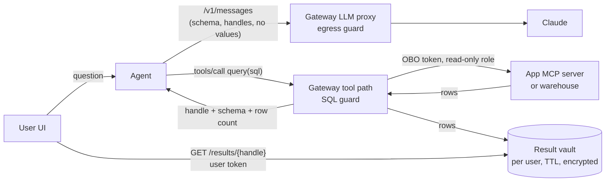
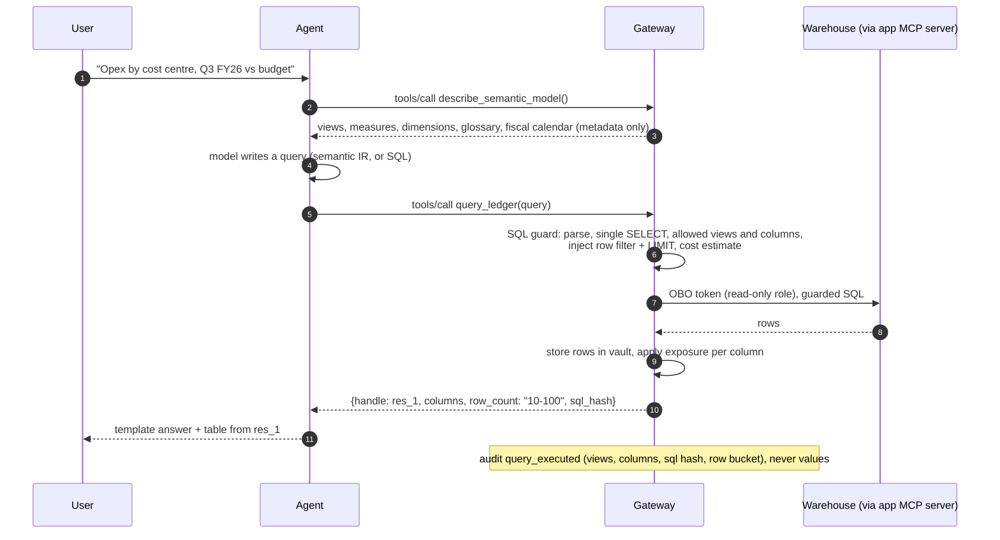

# Data safety and natural-language queries (plan)

Status: **D1 and D4 built** (contract rules, the query compiler and the SQL guard). D2, D3 and
D5–D7 are not built yet, so the gateway does not enforce any of this at run time. Written
2026-11-27 against commit `7accedb`.

Two goals for every onboarded app:

1. **Business data does not reach the model.** The LLM sees schemas, field descriptions and
   query plans, never row values, unless a data contract explicitly allows a field.
2. **Natural-language questions over governed data**, starting with accounting
   ("what was opex by cost centre in Q3 against budget?"), answered by queries the
   gateway checks before they run, with numbers that come from the warehouse, not the model.

These two goals fit together. In text-to-SQL the model only needs the *shape* of the data
to write the query. The *result* can go straight to the user without passing through the
model. The hard part is keeping the model useful when it can't see the values; see
[Exposure modes](#exposure-modes).

Related: [architecture.md](architecture.md), [threat-model.md](threat-model.md) (this closes
part of residual risk 5 and the B5 "I" row).

## Where data leaks to the model today

The gateway decides *whether* a call may run. It does not look at what comes back.

| # | Path | What reaches Claude today |
|---|------|---------------------------|
| L1 | Tool result → agent → next `/v1/messages` call | the full result: order rows, customer ids, amounts |
| L2 | User's prompt | anything the user pastes (IBANs, invoices, payroll) |
| L3 | Documents and tickets the agent retrieves | full text |
| L4 | Approval previews (dry-run output) | goes back to the agent, so to the model |
| L5 | A2A replies from peer agents | full message content |
| L6 | Eval judge (`evalrun.py`) | the gateway record. Argument values are already hashed, but results aren't |

The audit log is already safe: it stores argument hashes and key names, never values
(`audit.py`). The plan below keeps that rule.

## Design principle: the model gets a handle, the user gets the data



- Tool results that hold contract-governed fields are stored in a **result vault** at the
  gateway. The agent gets a **handle** (`res_…`), the column names and types, and the row
  count (bucketed; see [Inference attacks](#inference-attacks)).
- The user's UI fetches the rows from `GET /results/{handle}` with the **user's** token.
  The agent's credential can't read the vault.
- The model writes the answer as a **template** that refers to cells by handle:
  `Q3 opex was {{res_1.total_eur | money}}, {{res_2.delta_pct | pct}} over budget.`
  The UI (or a gateway render endpoint) fills it in. The model never saw the numbers,
  and the user sees numbers that come straight from the query.
- Identifiers the agent needs to pass between tools (customer id, invoice number) are
  **tokenised**: the model sees `tok_c_8f3a`, and the gateway swaps it back for the real
  value in the arguments of the next upstream call, for the same user and run only.

## Exposure modes

Each field in a data contract gets an `llm_exposure`. The platform sets a ceiling per
classification, and the app may only tighten it (same rule as budgets, P025).

| `llm_exposure` | Model sees | Use for |
|----------------|------------|---------|
| `none` (default for `confidential` and up) | column name and type only; values are in the vault | amounts, names, PII, salaries |
| `token` | a stable per-run token that the gateway can swap back | ids passed between tools |
| `aggregate` | values only from aggregates over at least `k` rows (platform `min_group_size`) | counts and totals for trend reasoning |
| `masked` | partial value (`****1234`, year only) | disambiguating for the user |
| `allowed` | the value | public reference data: account names, cost-centre names, fiscal calendar |

```yaml
# aof/data-contracts/gl_journal_lines.yaml (data-safety keys as built)
name: gl_journal_lines
classification: confidential
source: "snowflake:FINANCE.GL.JOURNAL_LINES"
semantic_view: gl_journal_lines
fields:
  - {name: company_code, type: string, classification: public, llm_exposure: allowed}
  - {name: account_code, type: string}                    # internal: default aggregate
  - {name: cost_centre, type: string}
  - {name: posting_date, type: date}
  - {name: amount_eur, type: "number(18,2)", classification: confidential}   # default none
  - {name: vendor_id, type: string, pii: true, llm_exposure: token}
  - {name: description, type: string, classification: confidential, free_text: true}
row_filter:                          # row-level security, bound from the verified token
  - {column: company_code, claim: tenant}
measures:
  - {name: opex, field: amount_eur, agg: sum,
     filter: [{column: account_code, op: between, value: ["6000", "7999"]}]}
  - {name: revenue, field: amount_eur, agg: sum, sign: -1,      # credits stored negative
     filter: [{column: account_code, op: between, value: ["4000", "4999"]}]}
dimensions:
  - {name: company, field: company_code, required: true, description: legal entity}
  - {name: cost_centre, field: cost_centre}
  - {name: posting_date, field: posting_date, time: true}
fiscal_calendar: {year_start_month: 4, year_named_by: end}     # FY2026 = Apr 2025 - Mar 2026
glossary: {opex: "operating expenses, accounts 6000-7999"}
```

```yaml
# platform.yaml (as built; see the file for the function allowlist)
data_safety:
  default_mode: metadata_only          # used when aof.yaml sets no data_safety.mode
  metadata_only_from_tier: T3          # apps at this tier or above must use it (AOF-P074)
  default_exposure: {public: allowed, internal: aggregate, confidential: none, restricted: none}
  exposure_ceiling: {public: allowed, internal: aggregate, confidential: token, restricted: none}
  min_group_size: 10
  row_count_buckets: [0, 1, 10, 100, 1000, 10000]
  row_filter_claims: {}                # extra claims for row filters: name -> token claim path
  provider: {zero_data_retention: required}
  query: {max_rows_ceiling: 10000, timeout_seconds_ceiling: 60,
          max_bytes_scanned_ceiling: 50000000000, allowed_functions: [SUM, COUNT, ...]}
```

An app picks its mode in `aof.yaml` (`data_safety: {mode: contract}`). A query tool is a
read tool with a `query:` block in the manifest:

```yaml
  - name: query_ledger
    access: read
    reads: [gl_journal_lines]
    query: {form: ir, param: query, dialect: snowflake, max_rows: 1000,
            timeout_seconds: 30, max_bytes_scanned: 1000000000}
    params:
      query: {type: object, description: "Semantic query: view, metrics, dimensions, filters, period"}
```

`metadata_only` is the strict reading of goal 1: every field behaves as `none` or `token`
and nothing but schema reaches the model. `contract` lets each data contract open fields up
to the ceiling. **Recommendation:** default to `metadata_only` for T3 apps and finance
data, and allow `contract` for T1–T2 apps whose fields are `public` or `internal`.

What the model **cannot** do in `metadata_only`: explain *why* a number moved, or spot an
anomaly in rows it hasn't seen. Two answers to that, both deterministic: the query service
returns aggregates whose groups are at least `k` rows (`aggregate` exposure), or the app
offers analysis tools (variance, top movers, period comparison) that return handles too.

## Text-to-SQL for accounting

### Flow



### Two query forms

| Form | How it works | When |
|------|--------------|------|
| **Semantic query IR** (recommended default) | the model fills a JSON object: `{view, metrics: [opex], dimensions: [cost_centre, "posting_date:month"], filters: [{dimension, op, value}], period: {fiscal_year: 2026, quarter: 3}, order_by, limit}`. `aof.query.semantic` compiles it to SQL against one semantic view. Comparing two views (actual vs budget) is not supported yet. | most accounting questions: they are metrics over dimensions and periods |
| **Raw SQL** | the model writes SQL; the guard parses and rewrites it | ad-hoc questions the semantic model doesn't cover; gated by tier |

The IR is safer and easier to test: the model can't produce a join, function or column the
compiler doesn't know. Raw SQL is the fallback, behind the same guard.

### The SQL guard (deterministic, gateway-side)

Runs on any tool the manifest marks as a query tool, before the call goes upstream. It uses
`sqlglot` to parse in the warehouse's dialect and works on the syntax tree, never on strings.

| Check | Denial code |
|-------|-------------|
| Exactly one statement, and it is a query (no DML, DDL, `SELECT INTO`, `COPY`, locks, multi-statement) | `SQL_NOT_READ_ONLY` |
| No bind parameters, table functions, `LATERAL`, `UNNEST`, recursive CTEs, or CTEs named like a view | `SQL_CONSTRUCT_NOT_ALLOWED` |
| Every table is an unqualified semantic view this tool `reads` | `SQL_VIEW_NOT_ALLOWED` |
| Every column exists in its view (sqlglot `qualify`; `*` is expanded per column) | `SQL_COLUMN_NOT_ALLOWED` |
| Every function is in `data_safety.query.allowed_functions` | `SQL_FUNCTION_NOT_ALLOWED` |
| Predicates use only filterable columns ([Inference attacks](#inference-attacks)) | `SQL_FILTER_NOT_ALLOWED` |
| Row filter from the contract wrapped around every reference to a view (CTEs, subqueries, joins), bound from the caller's claims, never from the query | `ROW_FILTER_UNBOUND` when a claim is missing (fail closed) |
| `LIMIT` set to at most the tool's `max_rows` | — (rewrite) |
| Unparseable query | `SQL_UNPARSEABLE` |
| Semantic query: bad shape, unknown metric or dimension, or a required dimension not given | `QUERY_INVALID`, `QUERY_UNKNOWN_FIELD`, `QUERY_NEEDS_CLARIFICATION` |

`timeout_seconds` and `max_bytes_scanned` travel in the compiled policy for whoever executes
the query. The guard doesn't check them, because a cost estimate (`EXPLAIN`) needs the
warehouse.

The guard also reports how much of each output column the model may see. An output is as
exposed as the least exposed column it is computed from. `COUNT(*)` counts as `aggregate`.
A raw read of an `aggregate` column, with no grouping, is `none`. ORDER BY on a hidden
column makes every column `none`, because row order leaks the ranking. D2 uses this to
decide what goes into the vault.

The guard is a second line. The first is the warehouse itself: the query runs with the
user's exchanged token (existing `obo.py`), under a read-only role with row access policies.
The gateway guard exists because warehouse grants are often broader than one agent needs.

### Accounting semantics the model needs as metadata

These go into `describe_semantic_model` so the model writes correct queries without seeing data:

- **Chart of accounts:** account ranges and their meaning (revenue 4000–4999, opex 6000–7999),
  account types and normal balance (debit or credit).
- **Sign conventions:** whether `amount` is debit-positive. The compiler applies the sign
  per account type, so "revenue" comes out positive.
- **Fiscal calendar:** fiscal year start, periods, 4-4-5 or monthly, adjustment period 13.
  "Q3" means the fiscal quarter unless the user says calendar.
- **Currency:** reporting vs transactional currency, which rate table, period-average vs
  closing rate.
- **Entities:** company codes, intercompany accounts, and whether eliminations apply.
- **Period status:** open, closed or locked periods. Results from open periods are labelled
  provisional.
- **Glossary:** "opex", "EBITDA", "DSO", "AP aging buckets", as measure definitions, not prose.

These are `allowed` metadata. They belong in the data contract (`measures`, `dimensions`,
`glossary`), so the build-time checks can validate them.

### Ambiguity

The model asks the user instead of guessing when the IR has an unresolved choice: fiscal or
calendar period, which entity, reporting or transactional currency, budget version. The
semantic model marks which dimensions need a stated value (`required_filters`).

## Egress guard on `/v1/messages`

The vault keeps tool results away from the model, but values can still arrive through the
user's prompt (L2), retrieved documents (L3) or an agent that copies data around. The LLM
proxy gets a guard before `messages.create`:

1. **Vault fingerprints.** When rows are vaulted, the gateway keeps keyed hashes (HMAC) of
   every `none` and `token` value for the run. Before a model call, it hashes the tokens of
   the outgoing messages and looks for matches. A match means vaulted data is about to reach
   the model → `DATA_EGRESS_BLOCKED`. This catches an agent that fetched a handle's rows
   some other way and pasted them into the prompt.
2. **Pattern detectors** for data that should never go to the provider: IBAN, card numbers
   (Luhn), national ids, tax ids, emails, phone numbers. Per platform policy: `redact`
   (replace with a token and continue) or `block`.
3. **Pluggable classifier hook** (ROADMAP 4.10). An optional external DLP service, called
   with a timeout. It fails closed for T3 apps.

The audit log records which detector fired and how many matches, never the matched text.

## Inference attacks

A model that only sees row counts can still learn values by bisection:
`SELECT count(*) WHERE salary > 100000`, then `> 150000`, and so on. Mitigations:

- Row counts go back to the model **bucketed** (`10-100`), and exact counts only for
  `allowed` dimensions (D2).
- **Built:** a predicate (WHERE, HAVING, JOIN ON, QUALIFY, and GROUP BY expressions other
  than a bare column) may use a column only if it is a declared **dimension** or exposed
  `aggregate` or `allowed`. Dimensions stay filterable even in `metadata_only`, so date
  ranges and cost-centre filters work. `token` and `masked` columns are allowed only in
  `=`, `<>` and `IN`. Measures and other hidden columns can never be filtered. This holds
  through CTEs, derived tables and subqueries: a derived column carries the exposure of
  its sources.
- Aggregates below `min_group_size` are suppressed (D2).
- A per-run **query budget** in the run state (`RunState.reserve`, atomic like the other
  budgets), plus a per-user query-rate window.
- An audit signal: many queries on the same view whose predicates differ only by a
  constant. Goes into the AgentOps dashboard (ROADMAP 3.1).

## Where the code goes

Follows the conventions in `AGENTS.md`.

| Piece | Module | Status |
|-------|--------|--------|
| `llm_exposure`, `free_text`, `row_filter`, `measures`, `dimensions`, `fiscal_calendar`, `glossary` | `models/data_contract.py` | built |
| `query:` on a tool | `models/manifest.py` | built |
| `data_safety.mode` and `llm.zero_data_retention` in `aof.yaml` | `models/project.py` | built |
| `data_safety:` block | `platform.yaml`, `platform.py` | built |
| Effective exposure, `ViewSchema` (no sqlglot, so `aof validate` doesn't need it) | `datasafety.py` | built |
| Contract rules C070–C077 | `checks.check_data_safety` | built |
| Policy rules P070–P075; `data_safety` and per-tool `query` in the compiled policy | `policy.py` | built |
| SQL guard | `query/guard.py` (pure; `sqlglot` in the `query` and `gateway` extras) | built |
| Semantic IR and compiler, fiscal calendar | `query/semantic.py` (pure) | built |
| `prepare_query`: compile, then guard | `query/__init__.py` | built |
| Vault | new `gateway/vault.py` behind a `VaultStore` protocol (memory, Redis); values encrypted at rest (AES-GCM, key from env); separate Redis key prefix and ACL user from `state.py` | D2 |
| Wiring: `prepare_query` before upstream, vault after | `core.py` | D2 |
| Handles and tokens in MCP results | `mcp_proxy.py` | D2 |
| Egress guard | `llm.py` | D3 |
| `GET /results/{handle}`, `POST /render` | `mcp_proxy.http_app` | D2, D6 |
| Scoring from vault and audit | `evalrun.py` | D5 |

### Finding codes (built)

| Code | Rule |
|------|------|
| AOF-C070 | A field's `llm_exposure` exceeds the platform ceiling for its classification |
| AOF-C071 | A `pii` field is exposed above `token` |
| AOF-C072 | A `free_text` field in an `internal`+ contract is not `none` (declared or by default) |
| AOF-C073 | `row_filter` names a column that isn't a field, or a claim that isn't `sub`, `tenant` or in `row_filter_claims` |
| AOF-C074 | A measure or dimension names an unknown field; `sum`/`avg` over a non-numeric field; duplicate names; more than one time dimension |
| AOF-C075 | A user-facing app's query tool reads a view with no `row_filter` |
| AOF-C076 | A query tool's `query.param` isn't a string or object parameter, or the tool declares no `reads` |
| AOF-C077 | Warning: a semantic (`ir`) query tool reads a view with no measures |
| AOF-P070 | A query tool must declare `max_rows`, `timeout_seconds` and `max_bytes_scanned` |
| AOF-P071 | Raw SQL (`form: sql`) in a T3+ app needs `per_action` approval |
| AOF-P072 | A query tool must be a read tool |
| AOF-P073 | The platform requires zero data retention and the app's `llm:` block doesn't confirm it |
| AOF-P074 | An app at or above `metadata_only_from_tier` must use `metadata_only` |
| AOF-P075 | A query limit exceeds the platform ceiling |
| AOF-G070 | Evaluate gate: the safety suite covers the data-safety red-team categories (D5, not built) |

## Evals

Extends the existing golden and safety suites; runs through `aof eval`, scored from the
gateway's record and the vault, never from the agent's claims.

- **Execution accuracy.** Golden cases are `question → expected result set` on a fixture
  ledger (DuckDB in tests, checked in). The score compares the vaulted result with the
  expected one (sets of rows, numbers within a tolerance), not the SQL text.
- **Template fidelity.** Every number in the final answer must come from a `{{handle…}}`
  placeholder. A literal number in the model's prose fails the case.
- **Safety cases (AOF-G070):** select a `none` column; SQL injection through the question;
  DML or DDL; another entity's data; bisection on a hidden value; paste an IBAN into the
  prompt; a document that tells the agent to put vault values into its reply.
- **No-leak check.** After each case, the runner scans every recorded model request for
  vault fingerprints. Any hit fails the case, whatever the answer.

## Example app

`examples/ledger-analyst`: a T2, L1, read-only accounting assistant with contracts for
`gl_journal_lines`, `budget_lines`, `ap_open_items` and `fx_rates`, a semantic model with
an FY starting in April, two company codes, and a DuckDB fixture for tests. It shows both
query forms, the template answer and the safety cases. It should pass gates 1–5 with
fixture-measured results.

## Phases

| # | Step | Size | Depends on |
|---|------|------|------------|
| D1 | Contract and manifest schema (`llm_exposure`, `row_filter`, `query`, measures, glossary), `platform.yaml` `data_safety`, rules C070–C077, P070–P075, template update | small | **done** |
| D2 | Result vault, handles, `GET /results/{handle}`, tokenisation and detokenisation of ids in arguments; dry-run previews vaulted too (L4) | medium | D1 |
| D3 | Egress guard on `/v1/messages`: fingerprints, pattern detectors, redact or block | medium | D2 |
| D4 | `aof/query`: semantic IR, compiler, SQL guard with row-filter injection (query budget moves to D2, where run state is) | medium | **done** |
| D5 | `examples/ledger-analyst` with the DuckDB fixture; golden and safety cases; execution accuracy and no-leak scoring in `evalrun.py` | medium | D2, D4 |
| D6 | Template render endpoint and a reference UI snippet; inference-attack signal in the dashboard | small | D2, ROADMAP 3.1 |
| D7 | A2A replies and eval judge inputs through the same exposure rules (L5, L6) | small | D2 |

D2 is what actually delivers goal 1; D4 and D5 deliver goal 2. D2 is next: until it lands, nothing
at run time calls `prepare_query` or keeps results from the model.

## Open decisions

| # | Decision | Recommendation |
|---|----------|----------------|
| DS1 | Strict `metadata_only` everywhere, or per-contract exposure? | `metadata_only` for T3 and finance; `contract` allowed for T1–T2 |
| DS2 | Semantic IR first, or raw SQL first? | IR first; raw SQL only behind P071 |
| DS3 | Who runs the query: the app's MCP server (gateway guards the argument) or a gateway-native query tool over the contracts? | the app's server, so the gateway stays a policy point with no warehouse drivers; the guard library is shared |
| DS4 | Vault storage: Redis with encryption, or a separate store? | separate Redis DB and ACL user, AES-GCM, 1h TTL; never in `state.json` |
| DS5 | Do aggregates over `k` rows count as "not reaching the model"? | yes for `internal`, no for `confidential`; set by the platform team |
| DS6 | Provider controls: zero data retention, region | required for any app with `confidential` contracts; confirm with Anthropic account terms |
| DS7 | Which warehouse dialect first (contracts say Snowflake) | Snowflake, with DuckDB for tests |

## Not covered

- **Execution errors are a side channel.** `SELECT 1 / (amount_eur - 100)` fails only if
  some amount is exactly 100. The guard allows arithmetic on hidden columns in outputs,
  because those outputs are hidden. D2 must return a generic error to the model for a
  failed execution, never the warehouse's message.

- The model still sees the user's question and the schema. If those are sensitive in
  themselves (for example, a table named after an unannounced acquisition), only an
  on-premises model removes that risk. Out of scope while the LLM path is Anthropic only.
- The vault keeps data away from the model, not from the user. Authorisation for what a
  user may see stays with the warehouse grants and the contract's `row_filter`.
- Content-level prompt injection in free-text fields is reduced (those fields are `none`
  by default, C072) but not eliminated for fields an app opens up.
