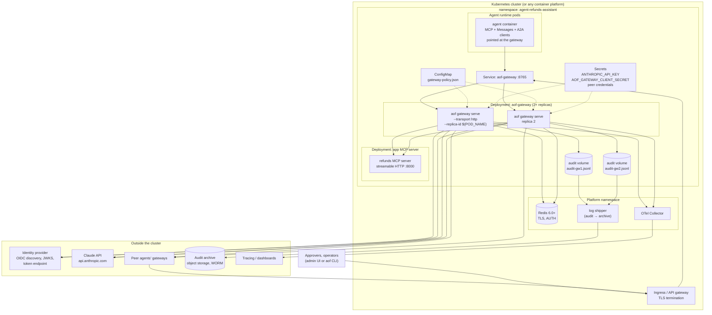
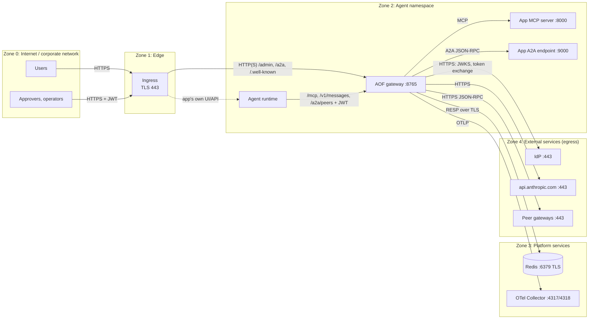

# Deployment and network

A reference production layout for one agent app behind the AOF gateway. The kit doesn't
ship deployment manifests yet (see [ROADMAP.md](../ROADMAP.md)); this is the shape they
should take. Component detail is in [architecture.md](architecture.md).

## Deployment

One gateway deployment per agent app. The gateway is stateless apart from its audit file,
so it scales out behind a load balancer once shared state is in Redis.



### Serve command

```bash
aof gateway serve \
  --policy /etc/aof/gateway-policy.json \
  --transport http --host 0.0.0.0 --port 8765 \
  --public-url https://refunds-gw.internal.example \
  --issuer-url https://idp.example --audience https://refunds-gw.internal.example \
  --upstream-url http://refunds-mcp:8000/mcp \
  --a2a-upstream-url http://refunds-agent:9000/ \
  --state-url rediss://redis.platform:6379/0 \
  --state-dir /var/lib/aof \
  --replica-id "$POD_NAME" \
  --token-endpoint https://idp.example/oauth2/token --client-id refunds-gateway
```

Check the flags against `aof gateway serve --help` for the version you deploy.

| Setting | Source | Notes |
|---------|--------|-------|
| `gateway-policy.json` | `aof compile-policy` in CI, mounted read-only | redeploy to change policy |
| `ANTHROPIC_API_KEY` | secret | only the gateway holds it; agents never see it |
| `AOF_GATEWAY_CLIENT_SECRET` | secret | the gateway's IdP client, for token exchange |
| peer credentials | secret, env var named in `aof.yaml` (`credential_env`) | or token exchange per peer audience |
| `AOF_STATE_URL` | config | Redis; required for more than one replica |
| `AOF_REPLICA_ID` | pod name | stamps audit records and names the audit file |
| `--tokens` | never in production | dev-only static tokens; the gateway prints DEV ONLY |

### Sizing and availability

- **Replicas.** At least 2. Limits (rate, budgets, approvals, kill switch) are enforced
  across replicas through Redis, so any replica can serve any call.
- **Redis is on the hot path.** Each decision makes one or more synchronous round trips.
  Run it with replication and keep it close to the gateway. If Redis is unreachable the
  call fails before reaching the app (fail closed); the gateway never falls back to local
  state. Today that failure surfaces as an unhandled error, with no stable code and no
  audit record (checked 2026-11-26; on the roadmap). Alert on gateway 5xx.
- **Audit volume.** One file per replica on a persistent volume. A replica that restarts
  with the same id continues its own chain.
- **Upstream MCP connections.** Without token exchange, one connection for the app's
  lifetime. With it, one connection per call (carries the user's exchanged token).

## Network

### Trust zones



The rule the network enforces: **the agent can reach only the gateway.** The app's MCP
server, the Claude API, peers and Redis are reachable from the gateway, not from the
agent. Without that, the agent can go around every policy.

### Network policy

| # | From | To | Port / protocol | Purpose |
|---|------|----|-----------------|---------|
| 1 | Agent runtime | Gateway | 8765 / HTTP(S) | `/mcp`, `/v1/messages`, `/a2a/peers/*` |
| 2 | Ingress | Gateway | 8765 / HTTP(S) | `/admin/*`, inbound `/a2a`, `/.well-known/*` |
| 3 | Gateway | App MCP server | 8000 / HTTP | tool calls (or stdio: same pod) |
| 4 | Gateway | App A2A endpoint | 9000 / HTTP | inbound A2A, forwarded |
| 5 | Gateway | Redis | 6379 / TLS | shared state |
| 6 | Gateway | OTel Collector | 4317 gRPC or 4318 HTTP | spans |
| 7 | Gateway | IdP | 443 / HTTPS | discovery, JWKS, token exchange |
| 8 | Gateway | api.anthropic.com | 443 / HTTPS | model calls |
| 9 | Gateway | peer gateways | 443 / HTTPS | outbound A2A (peers listed in `aof.yaml`) |
| — | Agent runtime | anything in rows 3–9 | — | **deny** |
| — | App MCP server | Internet | — | deny unless the app needs it; then an explicit allowlist |

Default-deny ingress and egress in the namespace, then allow exactly these rows. Egress
to rows 7–9 is easier to hold to an allowlist through an egress proxy.

### TLS

- Ingress terminates TLS from users, operators and peers. The gateway itself serves plain
  HTTP; inside the cluster use a service mesh for mTLS if your policy requires it.
- The gateway's own outbound calls to the IdP use HTTPS: the policy compiler rejects a
  non-HTTPS issuer, JWKS URI or token endpoint (AOF-P060, P061).
- A2A between gateways has no mTLS of its own yet; terminate it at the edge (roadmap).
