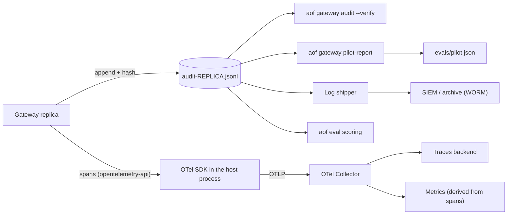

# Observability and audit trail

The gateway produces two streams:

- **Audit log.** Every decision, as an append-only, hash-chained JSONL file per replica.
  This is the record of what the agent did and why it was allowed. It is evidence, and
  the input to `aof gateway pilot-report`.
- **OpenTelemetry spans.** One per tool call and one per model call, using the GenAI
  semantic conventions. These are for tracing and latency, not evidence.



## Audit log

### Format

One JSON object per line, written with sorted keys and no spaces:

```json
{"seq":42,"ts":1764146400.12,"event":"tool_executed","agent":"agent:refunds-assistant",
 "user":"alice","run_id":"run-7","call_id":"c-19","tool":"create_refund_request",
 "args_sha256":"9f2c…","arg_keys":["amount","order_id","reason","request_id"],
 "code":"APPROVAL_REQUIRED","approval_id":"apr_…","approved_by":"lead-1",
 "on_behalf_of":{"audience":"refunds-api","scopes":["refunds:write"],"expires_in":300,"cached":false},
 "replica":"gw-1","prev":"5b1e…","hash":"c07a…"}
```

| Field | Meaning |
|-------|---------|
| `seq` | position in this replica's chain, from 1 |
| `ts` | Unix time, seconds |
| `event` | what happened (table below) |
| `prev` | hash of the previous record (`000…0` for the first) |
| `hash` | SHA-256 of this record's canonical JSON without `hash` |
| `replica` | replica id, when running several |
| `args_sha256`, `arg_keys` | the arguments as a hash plus key names; values are never stored |
| `code` | the policy verdict. For an approved write it stays `APPROVAL_REQUIRED`; `approval_id` and `approved_by` show it was approved |

Tokens are never written. An exchanged token appears only as its audience, scopes,
lifetime and whether it came from the cache.

### Events

| Event | Written when | Notable fields |
|-------|--------------|----------------|
| `gateway_started` | a replica starts | transport, autonomy_level, state (`shared` or `local`), upstream_credential |
| `tool_executed` | a tool call ran upstream | code, approval_id, approved_by, on_behalf_of, upstream_error, sampled_for_review |
| `tool_denied` | the policy denied a tool call | code, reason |
| `tool_failed` | the upstream call raised | code `UPSTREAM_ERROR` |
| `approval_requested` | a write was held for approval | approval_id, code |
| `approval_refused` | an approval id was presented but not usable | approval_id, code |
| `approval_decided` | a human approved or rejected | decision; `by` and `verified=true` from the admin API, `decided_by` and `verified=false` from the local CLI |
| `dry_run_failed` | the preview call failed | |
| `token_exchange_failed` | on-behalf-of exchange failed (call not made) | code |
| `llm_call` | a model call completed | model, message_id, stop_reason, token counts, cost_usd, run_cost_usd, priced |
| `llm_denied` | the policy denied a model call | code, model |
| `llm_failed` | the Claude API returned an error | status |
| `a2a_call` | an A2A call completed | direction, peer or caller, method, task_ids |
| `a2a_denied` | the policy denied an A2A call | code |
| `a2a_failed` | the peer or app endpoint failed | reason |
| `kill_switch_on` / `kill_switch_off` | an operator stopped or revived an agent | by, reason, verified |
| `autonomy_demoted` / `autonomy_restored` | level lowered (operator or SLO breach) or restored | from_level, to_level, by, reason |
| `admin_refused` | a signed-in caller without the operator role tried an operator action | action, code |

Every denial carries a stable `code` (for example `RATE_LIMITED`, `STEP_BUDGET`,
`MODEL_NOT_ALLOWED`, `TASK_NOT_OWNED`). The same code is returned to the agent, so the
agent can act on it and dashboards can group by it.

### Integrity

```bash
aof gateway audit --verify --state-dir /var/lib/aof
# audit-gw-1.jsonl: chain OK (18234 records)
# audit-gw-2.jsonl: chain OK (17950 records)
```

Verification recomputes every hash and checks every `prev`. It reports the first broken
`seq`. What it detects and what it doesn't:

| Change | Detected? |
|--------|-----------|
| a record edited | yes |
| a record deleted or inserted in the middle | yes |
| the last records removed | **no**, unless chain heads are anchored outside the host |
| the whole file rewritten with a new valid chain | **no**, same fix |

So ship records off the host as they're written (to WORM object storage or a SIEM) and
periodically record each replica's latest `seq` and `hash` somewhere the gateway can't
write. Both are on the roadmap; today it's a deployment task.

### Retention

The kit doesn't rotate or expire audit files. Keep them at least as long as the pilot
window plus your incident-response and regulatory requirements; ship them out before
rotating. Approval records in the state store have their own retention TTL.

## Traces

The gateway depends only on `opentelemetry-api`. Spans are no-ops until the host process
configures an SDK and exporter, for example:

```bash
pip install opentelemetry-sdk opentelemetry-exporter-otlp
OTEL_SERVICE_NAME=aof-gateway OTEL_EXPORTER_OTLP_ENDPOINT=http://otel-collector:4317 \
  opentelemetry-instrument aof gateway serve ...
```

| Span | Kind | Attributes |
|------|------|------------|
| `execute_tool {tool}` | INTERNAL | `gen_ai.operation.name=execute_tool`, `gen_ai.tool.name`, `gen_ai.tool.call.id`, `gen_ai.agent.id`, `aof.run_id`, `enduser.id`, `aof.code` (verdict), `aof.approval_id`; `error.type` on failure |
| `aof.gateway.chat {model}` | INTERNAL | `gen_ai.operation.name=chat`, `gen_ai.provider.name=anthropic`, `gen_ai.request.model`, `gen_ai.response.model`, `gen_ai.response.id`, `gen_ai.agent.id`, `aof.run_id`, `aof.stream`, `aof.cost_usd`, `enduser.id` |

Token usage is on the Anthropic SDK's own child span, not repeated on the gateway span.
A2A calls have no span yet (roadmap). The GenAI conventions are still in Development
status, so pin the version you emit in `platform.yaml` (`telemetry.genai_semconv_version`);
`aof validate` warns until it's pinned (AOF-P030).

## What to watch

Until the AgentOps dashboard exists, these come from the audit log (or from span-derived
metrics where noted).

| Signal | Source | Suggested alert |
|--------|--------|-----------------|
| Denials by `code`, per agent | `tool_denied`, `llm_denied`, `a2a_denied` | sudden rise in `RATE_LIMITED`, `STEP_BUDGET`, `COST_BUDGET` |
| Pending approvals and their age | state store `/admin/approvals`, `approval_requested` vs `approval_decided` | oldest pending > approver SLA |
| Approval agreement rate | `approval_decided` | below the tier's pilot threshold |
| Spend per run and per agent per day | `llm_call.cost_usd`, `run_cost_usd` | daily spend over budget |
| Model errors | `llm_failed` by status | 5xx or 429 rate |
| Upstream failures | `tool_failed`, `upstream_error` | error rate over SLO |
| Kill switch and demotions | `kill_switch_on`, `autonomy_demoted` | page on every one |
| Token exchange failures | `token_exchange_failed` | any sustained rate |
| State store errors | gateway logs / 5xx from the gateway (not audited yet) | any |
| Chain integrity | `aof gateway audit --verify` on a schedule | any failure |
| Latency | span durations | p95 over SLO |
| Unpriced model calls | `llm_call.priced=false` | any (a model missing from `platform.yaml` prices) |

## Querying the log

The files are JSONL, so `jq` is enough for ad-hoc questions:

```bash
# denials by code today
cat /var/lib/aof/audit*.jsonl | jq -r 'select(.event|endswith("_denied")) | .code' | sort | uniq -c

# who approved what
jq -c 'select(.event=="approval_decided") | {approval_id, decision, by, ts}' /var/lib/aof/audit*.jsonl

# spend per run
jq -r 'select(.event=="llm_call") | [.run_id, .cost_usd] | @tsv' /var/lib/aof/audit*.jsonl \
  | awk '{s[$1]+=$2} END {for (r in s) print r, s[r]}'
```
