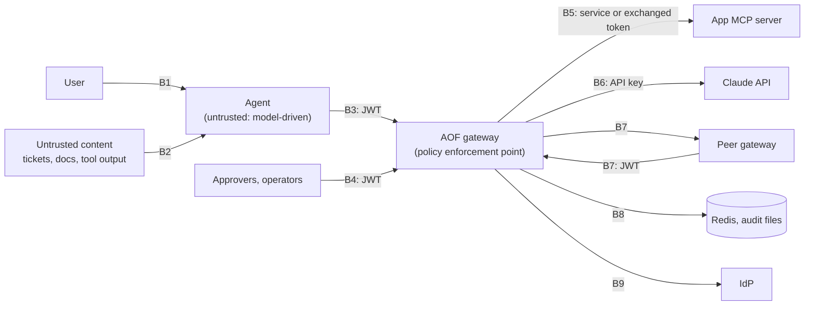

# Threat model

Scope: an agent app onboarded through AOF and running behind the AOF gateway, deployed as
in [deployment.md](deployment.md). Method: STRIDE per trust boundary, then the OWASP Top
10 for Agentic Applications (ASI01–ASI10). Each threat lists what AOF does today (with
the code that does it) and what is left. Gaps are tracked in [ROADMAP.md](../ROADMAP.md).

Reviewed 2026-11-26 against commit `7783ae7`.

## Assets

| Asset | Why it matters |
|-------|----------------|
| Business data and actions behind the app's tools | the reason an attacker would target the agent: refunds, tickets, customer data |
| End users' access tokens | let a holder act as the user |
| Exchanged (on-behalf-of) tokens | narrower, but still act as the user upstream |
| Gateway credentials: Claude API key, IdP client secret, peer credentials | spend, impersonation of the gateway |
| Compiled policy | defines what the agent may do |
| Approval records | a forged or replayed approval executes a write |
| Shared state (Redis) | kill switch, demotions, budgets, approvals |
| Audit logs | evidence; needed for the pilot gate and incident response |

## Actors

- **End user**, signed in, acting through the agent. May be malicious.
- **Prompt-injection author**: anyone whose text reaches the model (tickets, emails,
  documents, tool results, peer agents' replies).
- **Compromised or misbehaving agent**: assume the model can be steered to do anything
  the agent process can do. The gateway is designed around this assumption.
- **Malicious or compromised peer agent** (A2A).
- **Insider**: approver, operator, someone with access to the cluster or Redis.
- **External attacker** on the network.

## Trust boundaries

The gateway is the one place policy is enforced. Everything to its left is treated as
untrusted, including the agent.

## STRIDE by boundary

Status: ✅ mitigated in code, ◐ partly, ✗ not mitigated (gap).

### B3: agent → gateway

| STRIDE | Threat | Mitigation | Status |
|--------|--------|------------|--------|
| S | Forged or replayed token | `JwtVerifier`: signature against JWKS, requires `exp`, `iss`, `aud`, `sub`; asymmetric algorithms only (HS* and `none` refused, P062); `aud` must name this gateway | ✅ |
| S | Stolen bearer token used elsewhere | none: tokens aren't sender-constrained | ✗ DPoP or mTLS |
| S | Revoked token still accepted | accepted until `exp` | ✗ introspection or short TTLs |
| T | Agent changes arguments after approval | approval bound to a hash of the arguments, tool, user and agent; mismatch → `APPROVAL_MISMATCH` | ✅ |
| T | Agent resets budgets by sending a new `aof/run_id` or `x-aof-run-id`, or a lower delegation depth | per-run budgets trust the caller's run id and depth; per-user and per-agent rate limits, write limits and the kill switch still apply | ◐ gateway-issued run ids |
| R | Agent or user denies having made a call | every decision audited with user, agent, run, call id and argument hash; hash chain | ✅ |
| I | Agent sees tools it shouldn't | tools filtered by the user's scopes and the level; denied tools are hidden from `tools/list` | ✅ |
| D | Agent floods calls or tokens | rate limits (atomic sliding windows), step, model-call, cost and `max_tokens` caps | ✅ (cost can overshoot by one call) |
| E | Agent calls a write above its level | `engine.evaluate` by level; L0/L1 read-only; L2 approval for every write; T4 always denied | ✅ |
| E | Agent widens scopes during token exchange | requested scopes must be a subset; `OBO_SCOPE_WIDENED`, `OBO_SCOPE_DENIED` | ✅ |

### B4: approvers and operators → gateway

| STRIDE | Threat | Mitigation | Status |
|--------|--------|------------|--------|
| S | Someone approves as someone else | approver identity taken from the verified token, never the request body | ✅ |
| E | User approves their own request | `SELF_APPROVAL` always blocked | ✅ |
| E | Non-approver approves | approver role per tool (`APPROVER_ROLE`, `NOT_APPROVER`); operator role for kill/demote (`NOT_OPERATOR`) | ✅ |
| T | Approval consumed twice (two replicas) | single atomic state transition in the store; race-tested | ✅ |
| R | Operator denies killing or demoting | audited with `verified=true` and the token's subject; CLI local mode audited `verified=false` | ✅ |
| E | Rubber-stamping (ASI09) | approval shows a dry-run preview of the exact effect; sampled post-hoc review | ◐ approval UX is the app's |

### B5: gateway → app MCP server

| STRIDE | Threat | Mitigation | Status |
|--------|--------|------------|--------|
| E | Upstream trusts the gateway's broad service credential | token exchange: upstream gets a token for this user and audience, exchanged only after the policy allows the call; fails closed | ✅ when configured |
| I | Tool results carry injected instructions back to the model | none at the gateway (it doesn't inspect content) | ✗ out of scope; app and model |
| T | Upstream changes a tool's schema or behaviour | manifest vs live server conformance (`aof check-server`); policy built from the manifest | ◐ at build time, not continuously |

### B6: gateway → Claude API

| STRIDE | Threat | Mitigation | Status |
|--------|--------|------------|--------|
| I | Agent gets the API key | only the gateway holds it | ✅ |
| E | Agent uses an unapproved model, beta, server tool or MCP connector | allowlists (`MODEL_NOT_ALLOWED`, `BETA_NOT_ALLOWED`, `SERVER_TOOL_NOT_ALLOWED`, `MCP_CONNECTOR_NOT_ALLOWED`) | ✅ |
| D | Runaway spend | per-run cost cap and model-call budget; cost from usage × `platform.yaml` prices | ◐ one call can overshoot |

### B7: agent-to-agent

| STRIDE | Threat | Mitigation | Status |
|--------|--------|------------|--------|
| S | Unknown agent calls in | caller must be in `allowed_callers`; JWT verified | ✅ |
| S | Peer's agent card swapped | card fetched over HTTPS from the contracted URL; skills checked | ◐ no card signature check |
| E | Agent delegates to an unlisted peer | peer allowlist, L4 only | ✅ |
| D | Delegation loops (ASI08) | depth header +1 per hop, max depth, delegation budget | ◐ depth is caller-supplied on inbound |
| I | Another user reads someone's task | task ownership keyed by peer/caller and user (`TASK_NOT_OWNED`) | ✅ |
| T | Push notification callbacks to arbitrary URLs | push-config methods blocked (`PUSH_NOT_ALLOWED`) | ✅ |
| S | Network attacker between gateways | TLS at the edge | ◐ no mTLS between gateways |

### B8: state and audit

| STRIDE | Threat | Mitigation | Status |
|--------|--------|------------|--------|
| T | Audit records edited or deleted | hash chain per replica; `aof gateway audit --verify` | ◐ detects edits; truncating the tail or rewriting a whole chain needs external anchoring |
| I | Audit log leaks PII | arguments stored as a hash plus key names, not values; tokens never logged | ✅ |
| T | Someone with Redis access clears the kill switch or forges an approval | Redis AUTH and TLS, network policy | ◐ store isn't signed; protect Redis like a credential store |
| D | Redis outage | calls fail before reaching the app (fail closed) | ◐ safe, but the error has no stable code and isn't audited |
| R | Two replicas' logs can't be merged | records carry `replica` and timestamps; per-replica chains | ◐ no global ordering |

### B9: gateway → IdP

| STRIDE | Threat | Mitigation | Status |
|--------|--------|------------|--------|
| S | Fake IdP metadata or JWKS | HTTPS only (P061); discovery checks the metadata's issuer | ✅ |
| D | Unknown-`kid` flood forces JWKS refetches | refetch rate-limited (`min_refresh_seconds`) | ✅ |
| I | Client secret leaks | stored as a secret; sent only to the HTTPS token endpoint (P060) | ◐ no `private_key_jwt` |

## OWASP Top 10 for Agentic Applications

| Risk | How AOF addresses it | Where | Residual |
|------|----------------------|-------|----------|
| ASI01 Agent goal hijack | assume a hijack succeeds and limit the blast radius: level, scopes, approvals, budgets; red-team cases required by the evaluate gate | engine, gates (AOF-G043) | no input/output content filtering |
| ASI02 Tool misuse | per-tool access class, limits, approvals, dry-run preview; tool-design lint | engine, lint, core | — |
| ASI03 Identity and privilege abuse | verified user identity; token exchange per user and audience; scope subset | jwt_verifier, obo | no DPoP; no revocation check |
| ASI04 Agentic supply chain | tools and servers declared in a manifest and `server.json`; conformance check; peers declared | checks, conformance | registry service not built; no card signatures |
| ASI05 Unexpected code execution | no code-execution tool unless declared; server tools blocked on the LLM path | policy, llm | depends on the app's own tools |
| ASI06 Memory and context poisoning | none at the gateway | — | ✗ app's responsibility; red-team case required |
| ASI07 Insecure inter-agent communication | caller and peer allowlists, verified tokens, task ownership, push blocked | a2a_proxy | no mTLS, no card signatures |
| ASI08 Cascading failures | step, model-call, delegation and cost budgets; depth limit; auto-demotion on SLO breach; kill switch | engine, llm, a2a_proxy, core | caller-supplied run id and depth |
| ASI09 Human-agent trust exploitation | previews, no self-approval, approver roles, sampled review | approvals, core | approval UI quality is the app's |
| ASI10 Rogue agents | kill switch and demotion shared across replicas; audit of every decision | state, admin | no anomaly detection yet |

## Top residual risks

1. **Caller-supplied run id and delegation depth.** Per-run budgets can be reset by an
   agent that sends a new run id. Fix: gateway-issued run ids bound to the session or a
   signed run context.
2. **Audit log can be truncated or wholly rewritten by someone with file access.** Fix:
   ship records to WORM storage and anchor chain heads externally.
3. **Bearer tokens aren't sender-constrained or revocable before expiry.** Fix: DPoP or
   mTLS-bound tokens; short TTLs; optional introspection.
4. **A2A without mTLS or card signatures.** Fix: mTLS between gateways; verify signed
   agent cards.
5. **No content inspection.** Injected instructions in tool results or documents reach the
   model. Mitigated by blast-radius controls, not prevented. Fix: optional guardrail hook.
6. **Redis is trusted.** Anyone with write access can clear the kill switch. Fix: treat
   Redis as a credential store (network policy, AUTH, TLS, separate ACL user per
   gateway); consider signing kill-switch and approval records.
